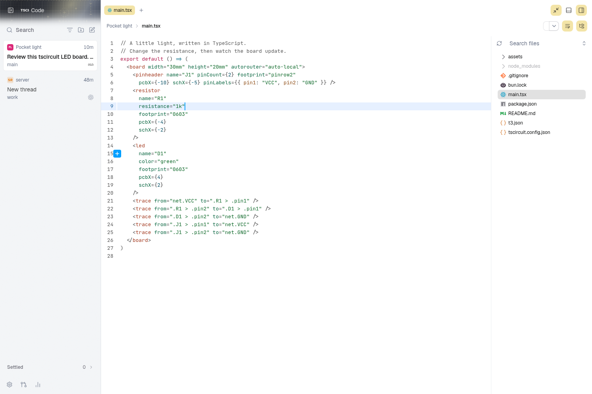
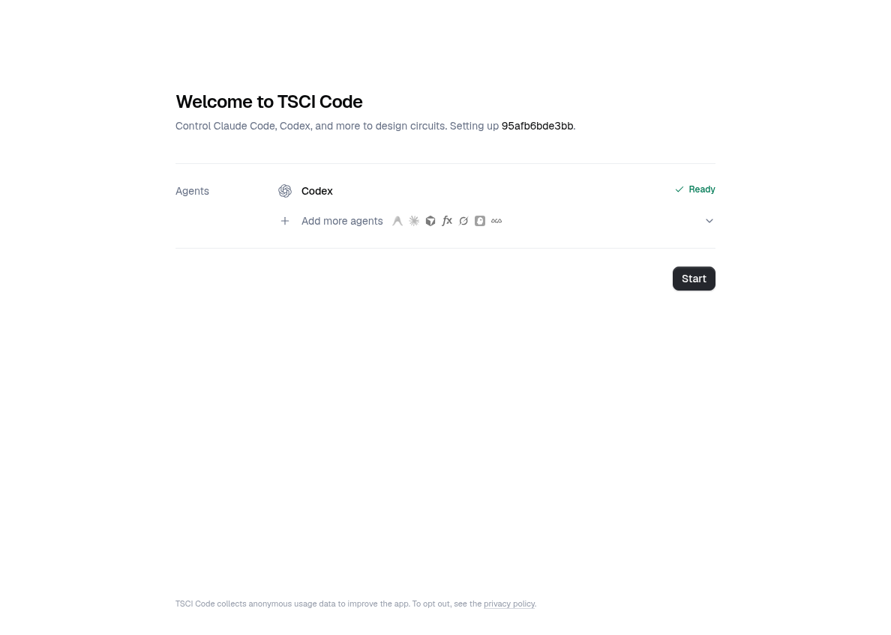
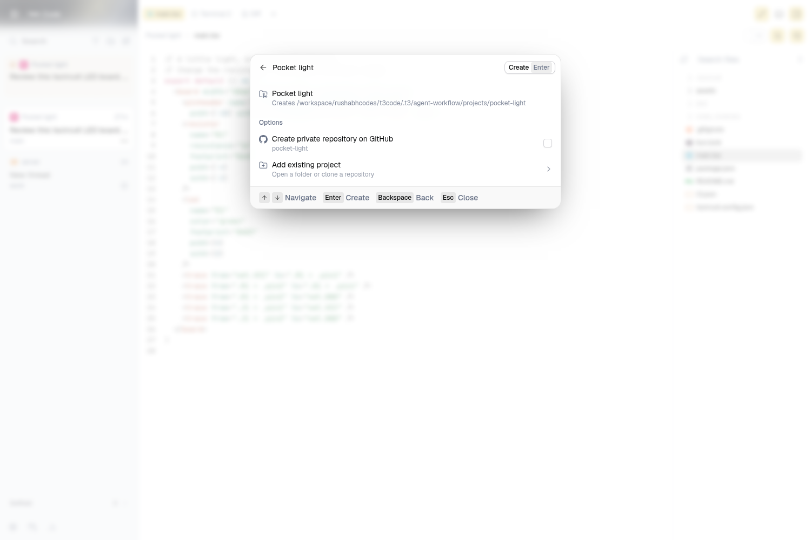
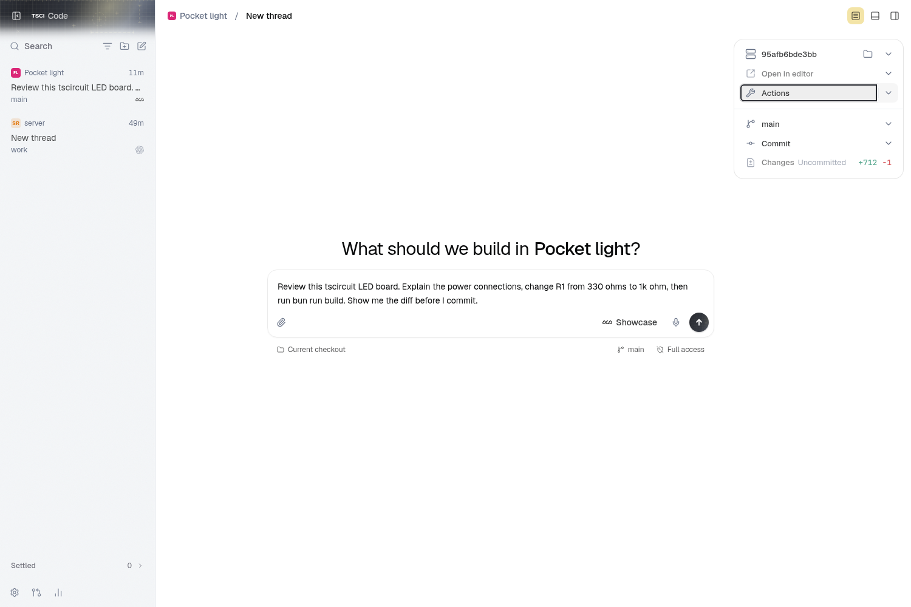
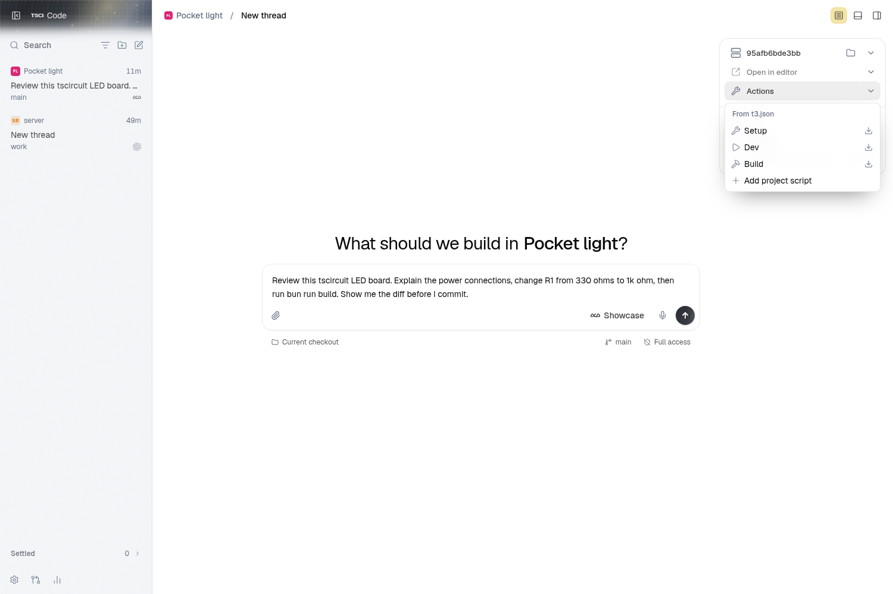
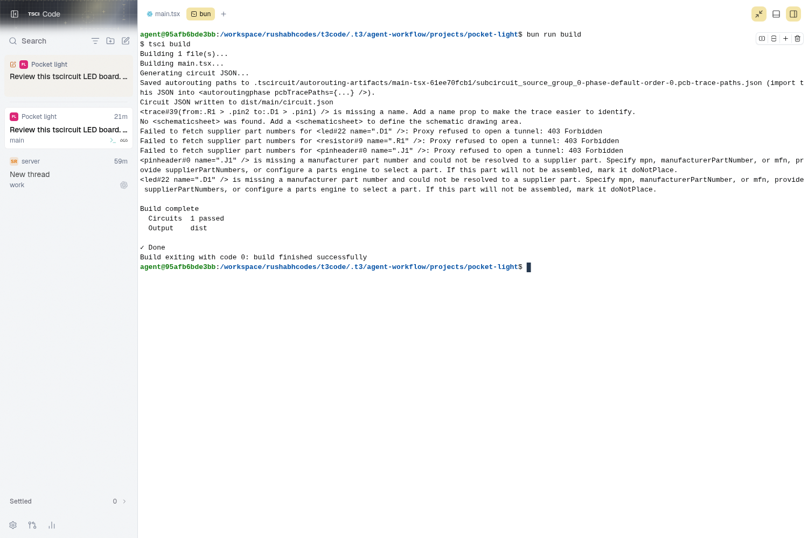
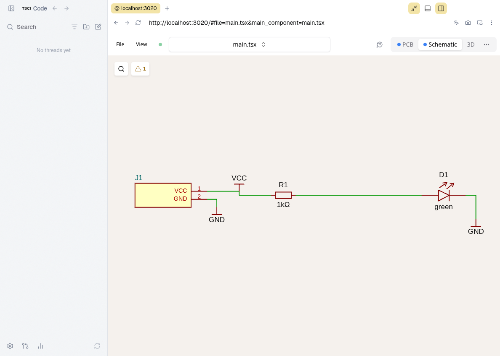
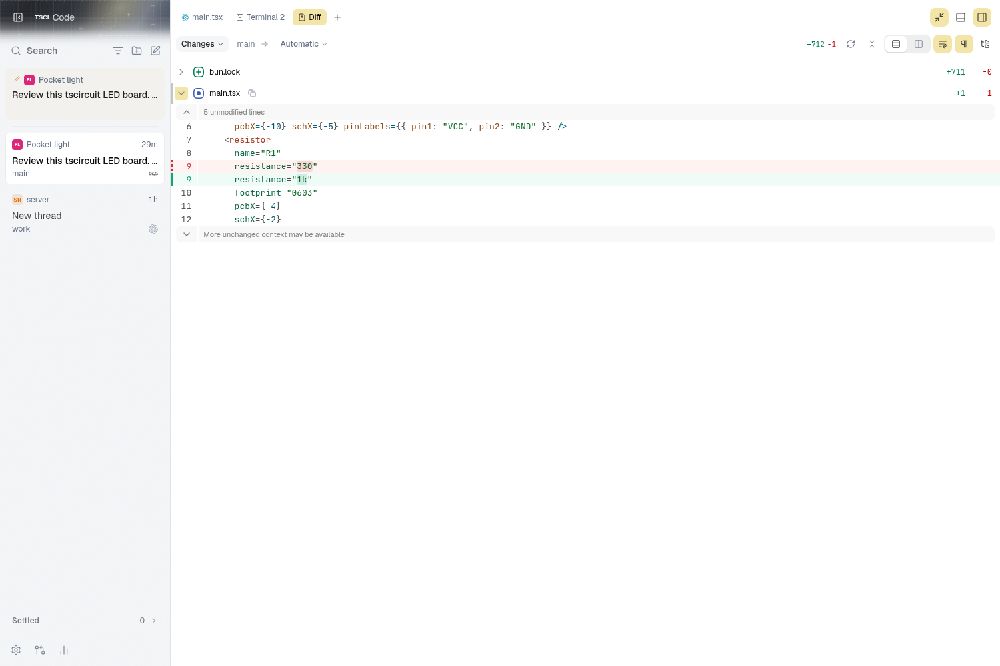
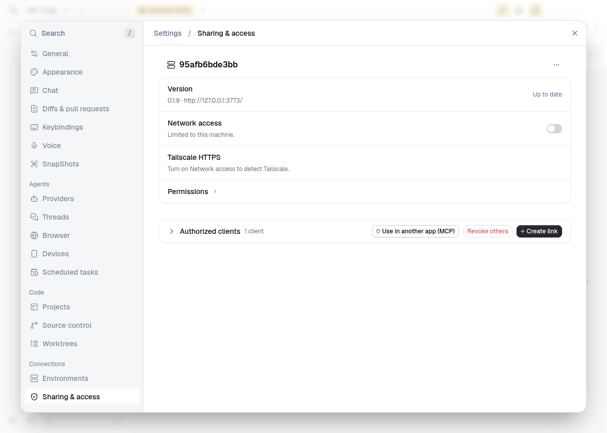
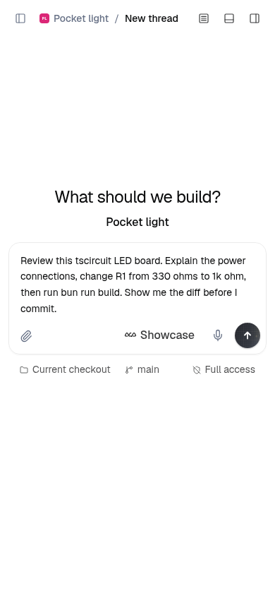

<p align="center"></p>
<h1 align="center">TSCI Code</h1>
<p align="center">Control Claude Code, Codex, and more to build circuits—from your computer or phone.</p>

TSCI Code is a circuit-focused fork of [T3 Code](https://github.com/pingdotgg/t3code). It keeps T3's agent threads, default file editor, terminal, Git review, Browser panel, and remote connections. Bring your coding agent, describe a circuit, review its TSX, and run the standard [tscircuit](https://tscircuit.com) tools in the same workspace.

The interface follows tscircuit.com's white, charcoal, and warm yellow palette, with Geist and JetBrains Mono. New projects start with a small LED circuit and ordinary project actions. Existing tscircuit repositories open through T3's existing project picker.



## Install and start

This fork currently ships as source. TSCI Code installers and a hosted TSCI service have not been published. Use the desktop development command below to run the complete Electron app.

### 1. Install the prerequisites

Install [Git](https://git-scm.com/downloads), **Node.js 26.12.1**, and [Bun](https://bun.sh/docs/installation). This repository pins **pnpm 12.14.0**. Bun runs the standard tscircuit CLI inside your circuit projects; the desktop application itself uses Node and Electron.

```sh
node --version                       # v26.12.1
npm install -g pnpm@12.14.0
pnpm --version                       # 12.14.0
bun --version

git clone https://github.com/rushabhcodes/t3code.git tsci-code
cd tsci-code
pnpm install
```

Install and sign in to at least one supported coding agent, such as [Claude Code](https://code.claude.com/docs/en/setup) or [Codex](https://developers.openai.com/codex/cli/). TSCI Code uses your agent's authentication and subscription. You can browse projects and run circuit commands without an agent; AI turns require a configured provider.

On Linux, desktop development also needs a C/C++ toolchain, `pkg-config`, and libsecret headers. On Debian 13 / Ubuntu 24.04:

```sh
sudo apt-get install build-essential pkg-config libsecret-1-dev libgtk-3-0t64 libnss3 libasound2t64 libgbm1
```

For other distributions, see [desktop prerequisites](docs/operations/development.md#linux-appimage-prerequisites).

### 2. Launch the original T3 desktop workflow

From the repository root:

```sh
pnpm dev:desktop
```

This starts the server, web renderer, and Electron shell. Keep the terminal open; **Ctrl C** stops the development launcher. If Electron's runtime is missing, run `pnpm --filter @t3tools/desktop ensure:electron` and try again.

For the web client, use:

```sh
pnpm dev
```

Open the **complete pairing URL** printed by the launcher. A fresh browser needs that URL to authenticate. The web client connects to the same kind of host server and workspace as the desktop app. Development data stays in the checkout's ignored `.t3` directory; desktop application profiles use the fork's separate TSCI paths.

## Walkthrough: your first circuit

These are captures of the running implementation. The composer screenshots use T3's free **Replay (dev) / Showcase** provider for demonstration; select your installed Claude Code, Codex, or another provider for real circuit changes. The circuit previews and build results come from the actual tscircuit CLI.

### 3. Complete the built-in agent onboarding

On first launch, T3's existing welcome screen checks the agents available on your host. Expand **Add more agents** to configure another provider, then select **Start**. You can return to agent configuration in Settings.



### 4. Create or open a project

Choose **Add project → New project**, or press **Ctrl K** (**⌘ K** on macOS) and search for **New project**. Enter **Pocket light** and create it. The existing GitHub option is optional; leave it unchecked to keep the project local.



The initial Git repository contains:

| File                    | Purpose                                                                |
| ----------------------- | ---------------------------------------------------------------------- |
| `main.tsx`              | A 30 × 20 mm LED board with J1, R1, D1, and connected traces.          |
| `package.json`          | The pinned tscircuit dependency and standard `dev` / `build` commands. |
| `tscircuit.config.json` | The `main.tsx` entry point.                                            |
| `t3.json`               | T3's existing Setup, Dev, and Build project actions.                   |
| `README.md`             | Instructions for that circuit project.                                 |

For an existing design, choose **Add existing project** and select a local folder, Git URL, or GitHub repository. Existing projects keep their files and configuration. Run commands from that project's README; its package scripts can be added through T3's existing project actions settings.

### 5. Choose an agent and start a thread

Use the model/provider selector in the existing composer. Give the agent a concrete circuit task, for example:

> Review this tscircuit LED board. Explain the power connections, change R1 from 330 ohms to 1k ohm, then run bun run build. Show me the diff before I commit.

Send the message to start the thread. Follow the agent's progress, answer questions, and review tool approvals using T3's standard controls. Your provider handles source changes and commands on the host machine. You can reopen the thread later to continue the work.



### 6. Inspect and edit the TSX in T3's default editor

Open the right panel and choose **Files**, or press **Ctrl P** (**⌘ P**) and search for `main.tsx`. The same editor, file tree, syntax highlighting, and save behavior that T3 provides are used here.

Try changing `resistance="330"` to `resistance="1k"`. The existing editor saves the file to your project on the host; **Ctrl S** (**⌘ S**) flushes the save. Changes made by an agent also appear in these files. The screenshot at the top shows the saved 1k edit.

### 7. Install, preview, and build with project actions

After starting a thread, open **Project actions** in the thread controls. Select **Setup**, then press its run button. Repeat with **Dev** to start the preview, or **Build** to check the circuit. Selecting an action chooses it; the adjacent run button executes it.



The actions run ordinary commands in T3's terminal:

| Action | Command         | When to use it                                                            |
| ------ | --------------- | ------------------------------------------------------------------------- |
| Setup  | `bun install`   | Once after creating or cloning the circuit, and after dependency changes. |
| Dev    | `bun run dev`   | Keep running while inspecting the schematic, PCB, or 3D preview.          |
| Build  | `bun run build` | After an edit and before reviewing generated design outputs.              |

You can also open **Terminal** and run the same commands yourself. Read its output for errors and warnings. A successful starter build reports `Circuits 1 passed` and writes to `dist/`.



### 8. Open the standard tscircuit preview in Browser

Dev prints a local URL, usually `http://localhost:3020`. Use the actual URL it prints if that port is occupied. Open T3's existing **Browser** panel and enter it. The preview is served by `tsci dev`; it is the standard tscircuit interface inside T3's Browser.

Switch between **PCB**, **Schematic**, and **3D** using the preview's own controls. Saving source while Dev is running updates the preview. In this example, **Schematic** shows R1 as **1kΩ**, matching the saved TSX.



The current PCB renderer requires WebGPU. If your browser or graphics driver reports no WebGPU adapter, use Schematic while checking GPU/browser support; the CLI build and exports can still run. Keep Dev running until you finish inspecting the circuit.

### 9. Review the Git diff and save your work

Open **Changes** or add the existing **Diff** surface. Review `main.tsx` and any dependency lockfile changes. Compare the source with the agent's explanation and the circuit preview. Use T3's normal commit and push controls when the changes are ready.



Projects remain normal folders and Git repositories. Commit the source and dependency lockfile so you can reopen the design on another machine. Stop Dev from its terminal when finished; reopen the project and run Dev again next time.

### 10. Export using the tscircuit CLI

After the build succeeds, run exports in the circuit project's terminal:

```sh
bun run build
bun run tsci export main.tsx --format schematic-svg --output dist/schematic.svg
bun run tsci export main.tsx --format gerbers --output dist/pocket-light-gerbers.zip
```

The starter is a learning circuit. Select manufacturer parts and review the electrical design, footprints, warnings, and fabrication rules before ordering. Supplier lookup failures and missing part numbers are visible in the CLI output. Use `bun run tsci export --help` for supported formats and options; [tscircuit documentation](https://docs.tscircuit.com) explains the design and export tools.

### 11. Continue from another computer or phone

T3's existing host/connection model carries over. The host runs the agents, owns the files, and must remain running and reachable. A connected device controls that host and its threads.

In **Settings → Connections → Sharing & access**, enable network access and use the existing **Create link** pairing control. **Environments → Add environment** connects another host. For development over a Tailscale network:

```sh
pnpm dev --share
```

Open the full pairing URL printed by that command on the other computer or phone. Keep pairing links private. The web UI adapts to a phone viewport; open the sidebar to switch projects or threads. The circuit dev URL shown as `localhost` belongs to the host—use the host's Browser surface when available, or a reachable address for a separately opened preview.





There is no published TSCI mobile app or hosted TSCI relay. The inherited native mobile sources and T3 service links belong to upstream T3 Code. See [remote access](docs/operations/development.md#sharing-and-remote-debugging) and the [mobile source README](apps/mobile/README.md) for the corresponding upstream workflows.

## Build the desktop application

For a local production build and launch:

```sh
pnpm build:desktop
pnpm start:desktop
```

To create an unsigned installer on the corresponding operating system:

```sh
pnpm dist:desktop:linux              # Linux x64 AppImage
pnpm dist:desktop:dmg                # macOS DMG
pnpm dist:desktop:win                # Windows NSIS installer
```

Artifacts are written to `release/`. Packaging uses T3's full desktop pipeline, including its native helpers. It requires the platform-specific toolchains, including Rust; read [desktop artifact prerequisites](docs/operations/development.md#desktop-artifacts) before packaging. The restored production desktop build and Linux Electron launch were verified for this implementation. Installers for macOS, Windows, and this restored full desktop pipeline have not been validated here.

## Development and verification

```sh
pnpm install --frozen-lockfile
pnpm exec vp test run apps/server/src/project/ManagedProjectFolders.test.ts apps/desktop/src/electron/ElectronProtocol.test.ts
pnpm build:desktop
pnpm exec vp run check:changed
```

The project creation tests cover the starter files, scripts, and initial Git commit. The walkthrough was exercised with isolated development state: creating a project, streaming a free Replay turn, editing and saving TSX in the default editor, building/exporting with the tscircuit CLI, and opening the schematic in the original desktop Browser. Phone imagery demonstrates the responsive web layout; native mobile devices and paid provider turns were not exercised for this change.

Existing `@t3tools/*` packages and `T3CODE_*` environment names remain compatible with the upstream codebase. See [CONTRIBUTING.md](CONTRIBUTING.md) and [development documentation](docs/operations/development.md) for the inherited architecture and contributor workflows.

## Credits and license

Built on [T3 Code](https://github.com/pingdotgg/t3code) by T3 Tools and its contributors, under the [MIT license](LICENSE). Circuit compilation, routing, previews, and exports come from [tscircuit](https://github.com/tscircuit/tscircuit). This is an independent fork; preserve upstream copyright notices and review [third-party license configuration](third-party-licenses.config.json) when distributing it.
