<p align="center"></p>
<h1 align="center">TSCI Code</h1>
<p align="center">The circuit is the code.</p>

TSCI Code is a local desktop workbench for designing electronics with **TypeScript and tscircuit**. Write a circuit, inspect its schematic and PCB, see the board in 3D, and export the files for your next step. It is built on the MIT-licensed [T3 Code](https://github.com/pingdotgg/t3code) desktop and agent platform.

The circuit editor needs **no account, API key, or installed coding agent**. The inherited agent workspace is available separately when you want help working on a source project.

## Install and launch

TSCI Code currently ships as source. There is no published installer to download yet. You can run the desktop app directly or build an installable package. The screenshots below show the real standalone editor on Linux; native Open/Save dialogs follow your operating system.

### 1. Get the source and dependencies

Install [Git](https://git-scm.com/downloads) and **Node.js 26.12.1**, then open a terminal. The repository pins **pnpm 12.14.0**.

```sh
node --version                       # v26.12.1
npm install -g pnpm@12.14.0
pnpm --version                       # 12.14.0
git clone https://github.com/rushabhcodes/t3code.git tsci-code
cd tsci-code
pnpm install
```

Keep the terminal open in the `tsci-code` directory for the commands that follow. The first install needs internet access to download dependencies.

### 2. Start the desktop app

```sh
pnpm dev                             # same as pnpm dev:desktop
```

The launcher builds the Electron shell, starts the renderer, and opens TSCI Code. The compiler, PCB router, schematic viewer, and 3D renderer are bundled locally. You do not need an account, API key, coding agent, or Rust toolchain for this editor.

Electron needs a graphical desktop and its usual OS runtime libraries. If its binary was not downloaded, run `pnpm --filter @t3tools/desktop ensure:electron`, then try again. Stop the development launcher with **Ctrl C** when finished; it also stops the processes it started.

To try the same editor in a browser instead:

```sh
pnpm dev:studio
```

Open the local URL Vite prints. Browser drafts belong to that browser profile and origin, so reuse the same port when returning to them. The desktop development app uses a stable origin for draft recovery.

### 3. Build a standalone package (optional)

For a Linux AppImage, run:

```sh
pnpm dist:desktop:linux
```

Find the generated `.AppImage` in `release/`. For example, the current x64 package can be started with:

```sh
chmod +x release/TSCI-Code-0.1.9-x86_64.AppImage
./release/TSCI-Code-0.1.9-x86_64.AppImage
```

Use the actual filename if the version or architecture differs. On Linux systems without working FUSE, run the AppImage with `APPIMAGE_EXTRACT_AND_RUN=1` before its path. This source and Linux packaging workflow has been exercised; macOS and Windows packaging commands are listed [below](#build-desktop-packages) and need their corresponding host OS.

## Walkthrough: from first launch to a saved circuit

Follow this small **Desk light** project through the entire workflow. The default appearance follows [tscircuit.com](https://tscircuit.com): white surfaces, charcoal controls, warm yellow highlights, Geist, and JetBrains Mono.

### 4. Meet your workbench

On first launch, read the welcome screen and select **Let’s build something**. If you already have a project, **Open existing** lets you skip the starter flow.


### 5. Choose a starter

Choose **Hello, LED** and press **Continue**. The other starters are **Voltage divider**, **RC low-pass filter**, and a blank board. Each gives you editable source rather than a locked example.


### 6. Name and create the project

Enter **Desk light** in **Project name**, then select **Create circuit**. The editor opens `main.tsx` and compiles the starter.


### 7. Find your way around

The explorer holds projects and source files. The middle pane edits TSX; the right pane previews the compiled circuit. Wait for **Circuit up to date** in the status bar. **Code**, **Split**, and **Preview** switch the layout; this walkthrough uses Split.

The **PCB** tab shows pads, routes, and the board outline. Scroll to zoom and drag to pan. The Problems row reports diagnostics that still need review, including warnings from starter circuits.

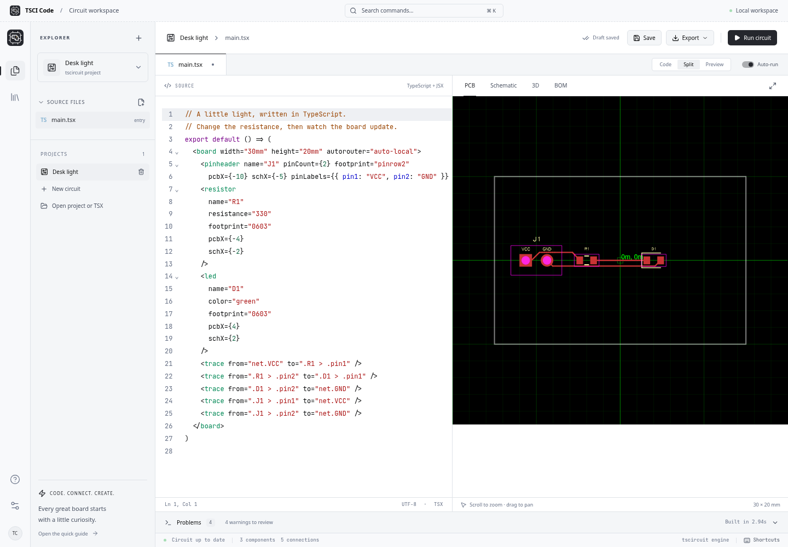

### 8. Edit a component and confirm the result

In `main.tsx`, change `resistance="330"` to `resistance="1k"`. With **Auto-run** enabled, the editor rebuilds after you pause typing. With it disabled, choose **Run circuit** or press **Ctrl Enter** (**⌘ Enter** on macOS).

Open **BOM**. R1 now reads **1000 Ω**, confirming the preview reflects your changed source. Device draft saving happens independently of compilation.

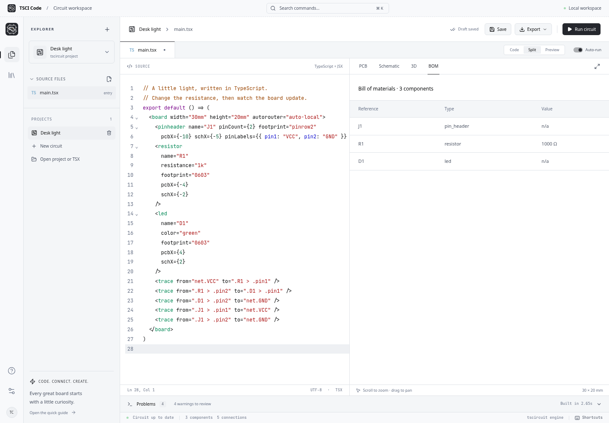

### 9. Inspect the schematic

Select **Schematic** to inspect the electrical connections and component labels. `schX` and `schY` control schematic placement independently of PCB placement. Review the viewer's warnings as well as the Problems panel.

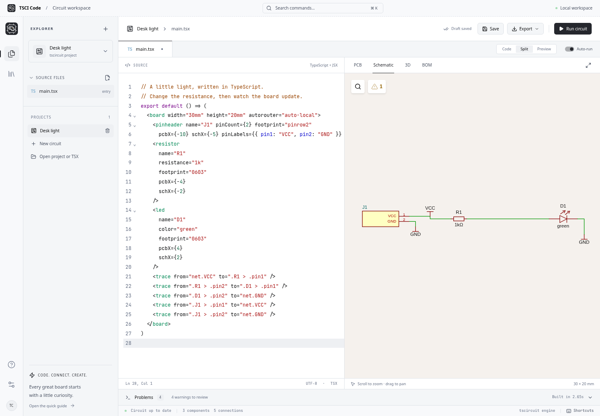

### 10. Inspect the board in 3D

Select **3D**. Drag to rotate, right-drag to pan, and scroll to zoom. The reset button restores a view of the whole board. The renderer shows the outline, drilled holes, pads, traces, and **generic component bodies**; detailed supplier CAD models are not included.


### 11. Explore the component library

Select **Component library** in the left rail to browse resistor, capacitor, and LED snippets. Inserting a snippet creates a unique reference. Set its positions and connect its pins with traces before treating it as part of a finished design. Select **Explorer** to return to your files.

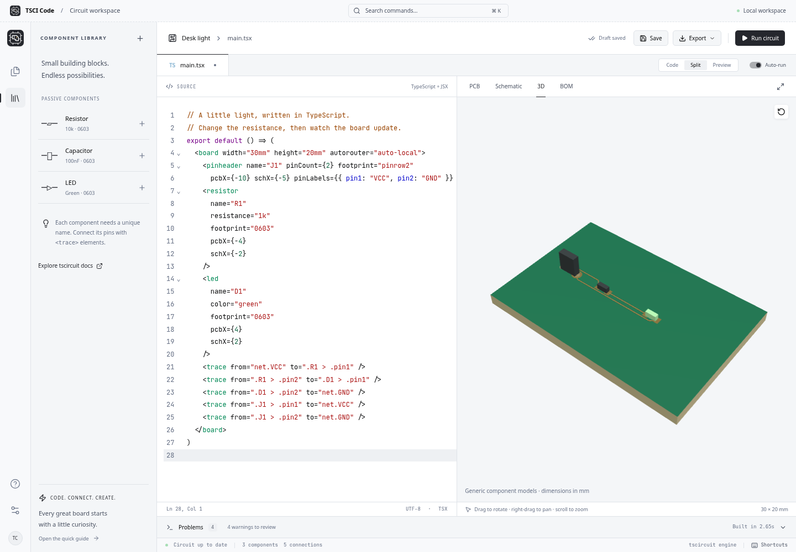

### 12. Understand build errors

Open **Problems** to inspect compiler and circuit diagnostics. For this screenshot, the source was deliberately changed to incomplete TSX and built. The editor shows **Build needs attention** while retaining the last successful preview; it also marks that preview as needing a rebuild.

Restore valid source and run it again. Fabrication exports stay disabled while the result is stale, building, or contains errors. You can still save your source while correcting it.

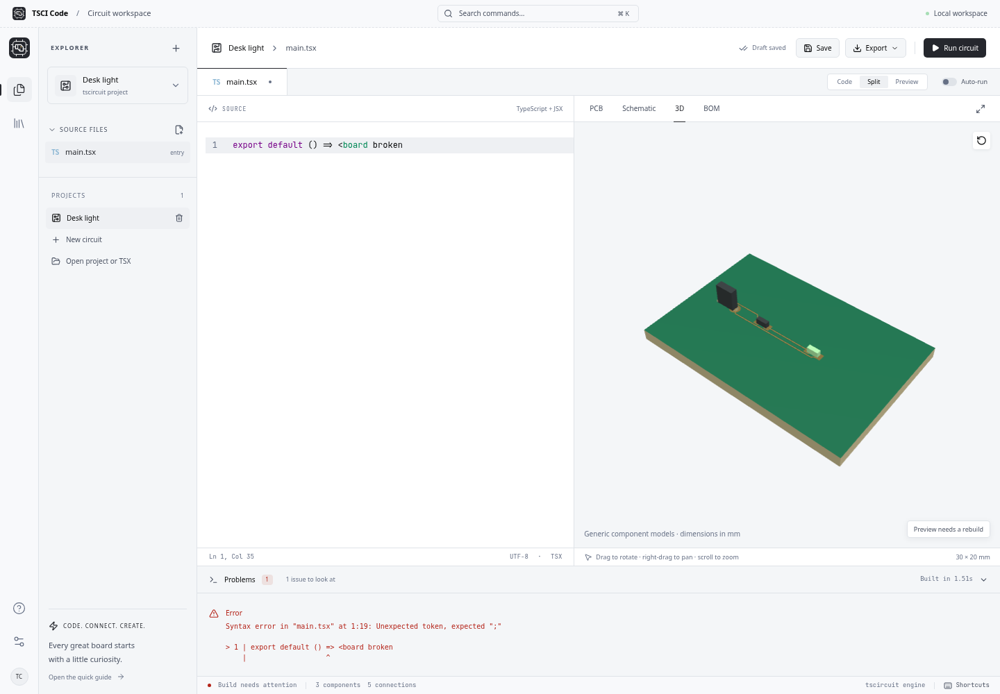

### 13. Save a portable project

After restoring a successful build, select **Save** or press **Ctrl S** (**⌘ S**). The desktop app opens a native save dialog the first time; choose a folder and save `desk-light.tsci.json`. Later saves update that file. **Save As** creates another copy.

You can also open **Export → TSCI project**. A `.tsci.json` file contains every source file and the entry point, so another installation can reopen it. In the browser, Save downloads the project instead of updating a chosen disk file. **Draft saved** only confirms device storage; keep this portable file as your backup.

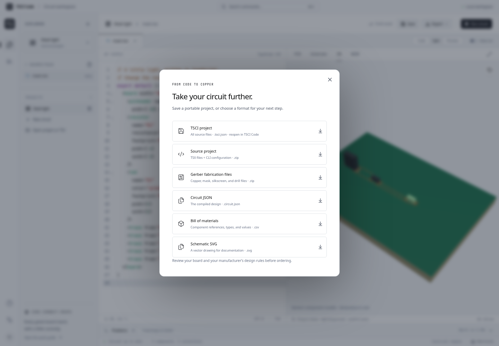

### 14. Export the files you need

In **Export**, choose **Gerber fabrication files** for a ZIP of copper, mask, paste, silkscreen, outline, and drill files. Choose **Bill of materials** for CSV, **Schematic SVG** for documentation, or **Circuit JSON** for other tscircuit tools. **Source project** exports the editable files with CLI configuration.

Wait for the export confirmation. On desktop, choose the destination in the native dialog; in the browser, check your download location. The example Gerber ZIP was opened and checked during this walkthrough. Review the board, footprints, electrical design, and your manufacturer's design rules before ordering.

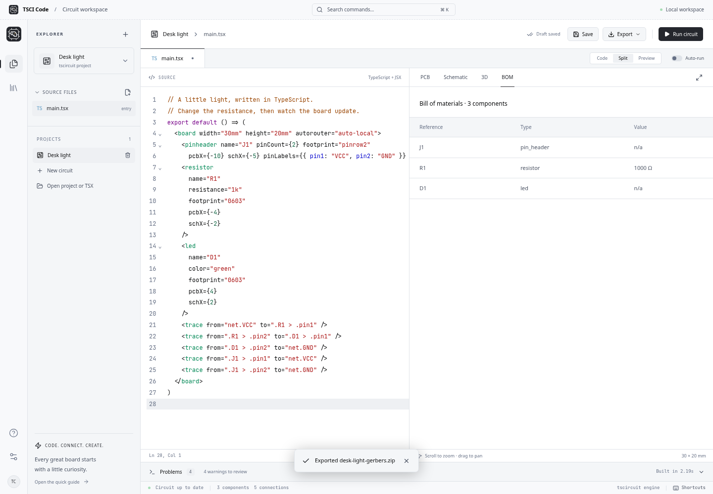

### 15. Use the command palette

Press **Ctrl K** (**⌘ K**) or select **Search commands…**. Search for project switching, new/open/save, exports, layouts, settings, or the guide. Close the palette to return to the editor. The [keyboard table](#keyboard-workflow) lists the main shortcuts.

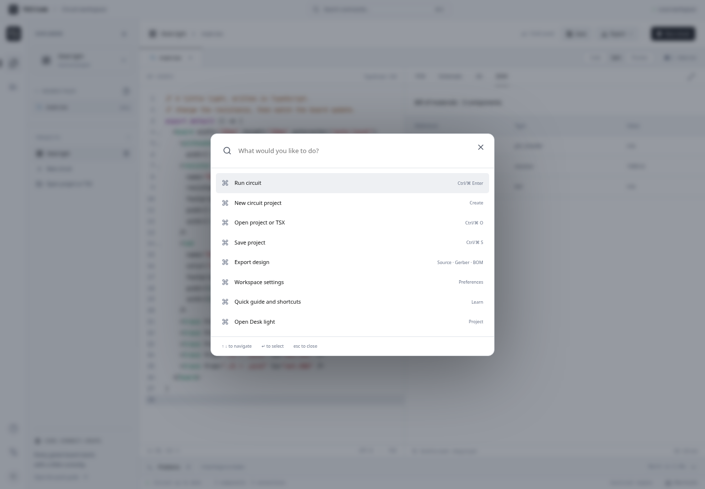

### 16. Set your preferences

Select **Workspace settings** in the left rail. Rename the project, choose the appearance, and set **Auto-run circuits**. Preferences stay on this device. Keeping auto-run off is useful when making several edits before compiling.

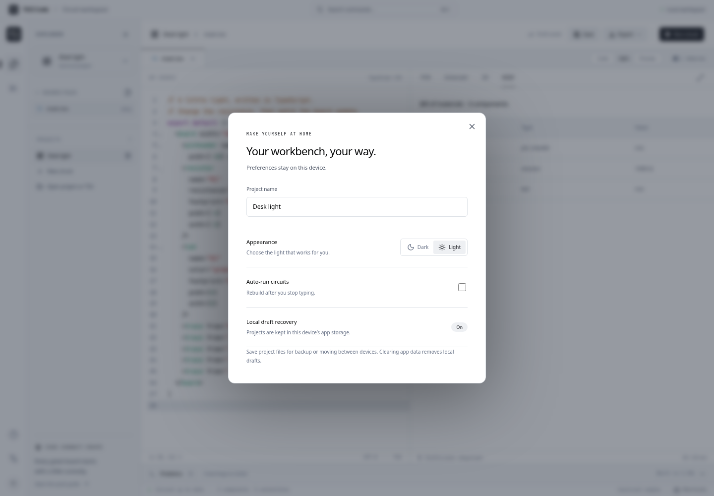

### 17. Try the optional dark appearance

Choose **Dark**, then close settings. Return to **Light** whenever you want the default tscircuit.com appearance. The source and saved project stay the same across both themes.

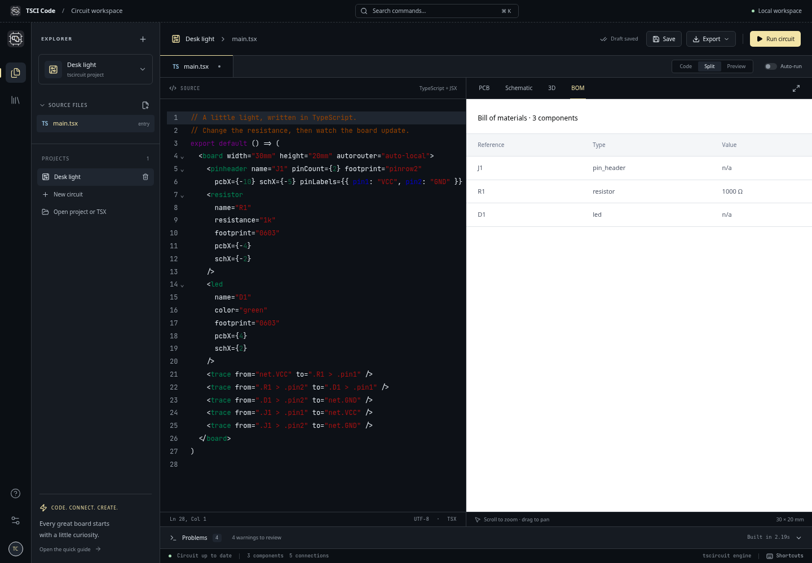

### 18. Return to a recovered draft

Wait for **Draft saved**, then close and reopen the app. The active project and edited source return from local storage. In the browser, reload the same URL in the same profile. This screenshot follows a reload with auto-run off: the restored project compiles on opening and R1 remains **1000 Ω**.

Clearing app/browser data removes local drafts. If recovery fails, use **Retry recovery** or a temporary workspace and save your files manually; the app does not report failed storage as saved.

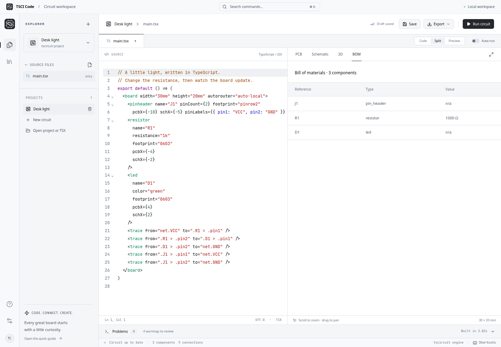

### 19. Reopen your saved file on another workspace

Use **Open project or TSX** in Explorer or **Ctrl O** (**⌘ O**), then choose `desk-light.tsci.json`. You can also select **Open existing** on the welcome screen. Wait for compilation and check the source and BOM.

The screenshot below imports the saved file into a fresh browser profile with no prior drafts. The project name, source, and **1000 Ω** value are preserved. `.tsx` and `.jsx` files can also be opened; a portable project is the choice for keeping multiple files together.


To repeat the welcome flow, open **Guide → Replay the welcome tour**. The guide also explains component coordinates and trace selectors.

## Write circuits with TSX

A circuit entry point exports a component containing a board. Components need unique names; footprints and dimensions use tscircuit's units and conventions.

```tsx
export default () => (
  <board width="30mm" height="20mm" autorouter="auto-local">
    <pinheader name="J1" pinCount={2} footprint="pinrow2" pcbX={-10} schX={-5} />
    <resistor name="R1" resistance="330" footprint="0603" pcbX={-4} schX={-2} />
    <led name="D1" color="green" footprint="0603" pcbX={4} schX={2} />
    <trace from="net.VCC" to=".R1 > .pin1" />
    <trace from=".R1 > .pin2" to=".D1 > .pin1" />
    <trace from=".D1 > .pin2" to="net.GND" />
    <trace from=".J1 > .pin1" to="net.VCC" />
    <trace from=".J1 > .pin2" to="net.GND" />
  </board>
);
```

Use `pcbX`/`pcbY` for board positions and `schX`/`schY` for schematic positions. The component library inserts resistor, capacitor, and LED snippets with unique references. Place inserted components and add their connections before manufacturing.

Create more files with the explorer's **New source file** action. Relative imports resolve inside the project:

```tsx
import { Indicator } from "./components/Indicator";
```

The active file can differ from the entry point. Select **Use as entry point** on another TSX/JSX file to build it instead. The editor supports syntax highlighting, search, undo/redo, bracket matching, tab indentation, and circuit-aware completion. See the [tscircuit documentation](https://docs.tscircuit.com) for the full component API.

## Files, drafts, and recovery

- **Projects:** up to 20 local projects, each with up to 100 source files and a 2 MB portable project limit. Import `.tsci.json`, `.tsx`, or `.jsx` with Open.
- **Local recovery:** changes are saved to IndexedDB after a short pause. “Draft saved” means the device transaction completed; it does not mean a file was written to disk. The editor warns before leaving while a draft is uncommitted or storage has failed.
- **Desktop Save:** native dialogs choose the destination. Later saves update that chosen file with an atomic replacement. Opening a single TSX/JSX file and saving it preserves the source format. Use Save As to create a complete project instead.
- **Browser Save:** downloads a portable project. Browser drafts stay in that browser profile and origin.
- **Recovery failures:** retry without changing the saved workspace, or enter a clearly marked temporary workspace and save files manually. A storage failure never becomes a “saved” status.
- **Backups:** exported files remain on disk when a local draft is removed. Clearing app/browser data removes local drafts. Save project files for backups and moving between devices.

The compiler is bundled locally and runs in a disposable web worker. Editing cancels obsolete builds, and a 30-second ceiling stops stalled code or routing. Built-in starters compile without a hosted rendering service. Automatic supplier lookups are disabled for local editing. Add part numbers explicitly when preparing a BOM. External package imports and custom 3D assets can require internet access. Project source is executable TypeScript; open source from people you trust.

TSCI Code uses its own desktop identity (`com.tsci.code`), protocol (`tsci-code://`), and Chromium profiles (`tsci-code-studio` and `tsci-code-studio-dev` inside your OS app-data directory). It can coexist with T3 Code. Set `TSCI_USER_DATA_DIR` to an isolated directory for testing. Internal `@t3tools/*` package names and `T3CODE_*` variables remain for compatibility with the optional agent platform.

## Export formats

| Format          | Use                                                                                          |
| --------------- | -------------------------------------------------------------------------------------------- |
| `.tsci.json`    | Reopen the full editable project in TSCI Code                                                |
| Source ZIP      | TSX/source files, `tscircuit.config.json`, and a package manifest with `dev`/`build` scripts |
| `.circuit.json` | Compiled tscircuit design for other tools                                                    |
| BOM CSV         | Component references, types, values, and available manufacturer part numbers                 |
| Schematic SVG   | A vector drawing for documentation                                                           |
| Gerber ZIP      | Copper, solder mask, paste, silkscreen, outline, and Excellon drill files                    |

Source/project exports work before a build. Compiled exports require a current result, and Gerbers additionally require no build errors. Circuit checks do not replace electrical review, a manufacturer's DRC, or checking footprints and part availability.

## Keyboard workflow

| Action          | macOS      | Windows / Linux |
| --------------- | ---------- | --------------- |
| Command palette | ⌘ K        | Ctrl K          |
| Save            | ⌘ S        | Ctrl S          |
| Save As         | ⌘ Shift S  | Ctrl Shift S    |
| Open            | ⌘ O        | Ctrl O          |
| Run circuit     | ⌘ Enter    | Ctrl Enter      |
| Autocomplete    | Ctrl Space | Ctrl Space      |

The command palette includes project switching, new/open/save, exports, settings, and the guide. Settings controls dark/light appearance and auto-run.

## Work with an agent

The inherited T3 agent platform remains available as a separate workflow:

```sh
pnpm dev:agents                 # web editor plus local agent server
pnpm dev:desktop:agents         # inherited desktop with agent server
```

In the full web application, choose **Coding agents** in the circuit editor's left rail. Export a source ZIP, extract it into a folder, and add that folder to the agent workspace. Connect an installed, authenticated provider such as Codex or Claude Code, then reopen the updated source in the circuit editor.

Agent work uses your provider account and subscriptions. Circuit drafts and agent folders do not synchronize automatically. The wordmark in the agent workspace returns to the circuit editor. The compact desktop build contains the circuit workflow; it does not start the agent platform. The inherited desktop workflow needs the native build prerequisites in [the development runbook](docs/operations/development.md).

## Build desktop packages

```sh
pnpm build:desktop
```

Package on the corresponding host OS:

```sh
pnpm dist:desktop:linux       # Linux AppImage
pnpm dist:desktop:dmg         # macOS DMG
pnpm dist:desktop:win:x64     # Windows x64 installer
```

Artifacts are written under `release/`. `pnpm start:desktop` opens an existing build. Windows and macOS signing/notarization require your own credentials. This compact editor has no automatic update feed; distribute new installers through your own releases.

Production builds generate third-party notices and fail if a dependency lacks a distributable notice. Compatible viewer releases are pinned, and verified license declarations/notices are recorded in `third-party-licenses.config.json`. Keep this check enabled when updating dependencies.

Regenerate the web and desktop icons from `assets/tsci/logo.svg` with `pnpm icons:export`; verify them with `pnpm icons:check`.

## Development checks

```sh
pnpm --filter @t3tools/web typecheck:studio
pnpm exec vp test run apps/web/src/circuits/project.test.ts
pnpm --filter @t3tools/web exec vp test run --project browser src/circuits/compiler.browser.test.ts
pnpm --filter @t3tools/desktop exec vp test run src/circuits/CircuitFiles.test.ts src/electron/ElectronProtocol.test.ts
pnpm check:changed
```

For an existing Chromium installation in CI, set `TSCI_CHROMIUM_PATH=/path/to/chromium` for browser tests. Otherwise use Playwright's installed Chromium. The worker tests compile every starter and exercise fabrication exports, invalid TSX, and cancellation. Native file tests cover destination grants, cancellation, atomic writes, and binary exports.

## License and credits

[MIT](LICENSE). The original T3 Code copyright and license are retained. TSCI Code is a derivative project, not an official T3 Code release. Circuit compilation and viewers come from the [tscircuit ecosystem](https://github.com/tscircuit); the editor uses CodeMirror. Third-party notices remain in `third-party-licenses/`. The 3D pane uses Three.js to render the board outline, drilled holes, pads, traces, and generic component bodies directly from Circuit JSON. It redraws on camera input, resize, and circuit changes. Detailed supplier CAD models are not included.

The product is named TSCI Code. The GitHub repository is still `rushabhcodes/t3code`; the remote repository slug has not been renamed.
